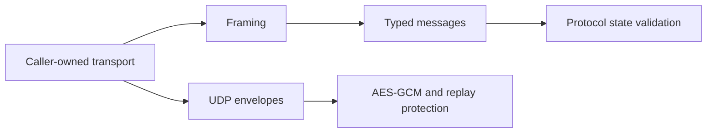

# OpenControl Protocol Library

**English** · [Русский](README.ru.md)

[](https://github.com/nr084/opencontrol-protocol/actions/workflows/quality.yml)
[](rust-toolchain.toml)
[](LICENSE)

An independent Rust library for the OpenControl Protocol: wire codecs, protocol
state validation and cryptographic session primitives in one reusable dependency.

**Crate:** `opencontrol-protocol` · **Library version:** `0.2.0` · **Wire versions:** `1–4`

## Features

- Incremental control framing for fragmented and coalesced TLS application bytes.
- Typed control messages, version-dependent configuration and lossless unknown messages.
- Exact encoding, resource limits and typed errors.
- Explicit client/server ordering validation for handshake and key rotation.
- Stateful, idempotent ROUTES updates with explicit changed/unchanged results.
- UDP envelopes, AES-128-GCM data packets and per-slot replay protection.
- Synthetic fixtures, golden vectors, property tests and three fuzz targets.

The application owns sockets, TLS verification, authentication decisions, clocks,
endpoint binding and network configuration. Parsing is synchronous and requires
no async runtime. The library contains no VPN server, TUN/TAP management, route
installation or firewall configuration.

## Architecture



## Installation

Version 0.2.0 is available on GitHub as tag `v0.2.0`. It is not published to crates.io.

Add a Git dependency to your application's `Cargo.toml`:

```toml
[dependencies]
opencontrol-protocol = { git = "https://github.com/nr084/opencontrol-protocol.git", tag = "v0.2.0", version = "=0.2.0" }
```

For reproducible builds, optionally replace `tag` with a reviewed commit's `rev` and commit
your application's `Cargo.lock`. For a local checkout, adjust this path to your layout:

```toml
[dependencies]
opencontrol-protocol = { path = "../opencontrol-protocol/crates/opencontrol-protocol" }
```

The project follows the latest stable Rust through [rust-toolchain.toml](rust-toolchain.toml).
Sanitizer fuzz campaigns use a separate nightly toolchain.

## Usage

The caller supplies bytes already decrypted by its TLS transport:

```rust
use opencontrol_protocol::*;

fn example() -> Result<(), ProtocolError> {
    let limits = ProtocolLimits::default();
    let mut decoder = ProtocolDecoder::new(limits);
    let incoming = [0x4b, 5, 0, 22, 4];
    let mut remaining = incoming.as_slice();

    while !remaining.is_empty() {
        let consumed = decoder.push_bytes(remaining)?;
        remaining = &remaining[consumed..];
        if let Some(frame) = decoder.next_frame()? {
            let message = ControlMessage::decode(frame, WireVersion::V4, limits)?;
            assert!(matches!(message, ControlMessage::Version(WireVersion::V4)));
        }
    }
    decoder.finish()?; // At EOF, not between reads.

    let response = ControlMessage::Ok(vec![]);
    let outgoing = ProtocolEncoder::new(limits).encode(&response, WireVersion::V4)?;
    assert_eq!(outgoing.as_ref(), &[0x4b, 5, 0, 3, 0]);
    Ok(())
}
```

`push_bytes` consumes at most one frame. Drain `next_frame` before feeding the
remainder, and retain the decoder across reads. Use `StateMachine::version()` after
negotiation to select the payload layout. Observe both received messages and
successfully sent responses through the state machine; this example shows codecs only.

`DataCipher` owns one cipher slot. Keep two independent slots during rotation:
installation resets counters, promotion does not. `seal` generates OS-random nonces.
Use `Datagram::decode` and `DataCipher::open` before delivering inner packets.
Match a CONNECT secret in the application before sending `SecretReceived`.

### Repeated ROUTES in an active session

ROUTES may arrive repeatedly, including periodic unchanged updates. Keep one
`RouteState` from the initial message through the entire session and apply every
subsequent `Routes`. `RouteUpdate::Unchanged` is a successful no-op: do not disconnect,
reset keys or recreate the VPN interface. `Changed` provides the full current
`RouteConfiguration` for the platform to apply, including default routes and status.
Unknown bits have no invented policy.

For acknowledged OS application, apply to a cloned candidate and commit after platform
success, including unchanged results (maintenance metadata matters). Run
`cargo run --example client_routes` for a virtual-time consumer at0/600/1200/1201
seconds with rekey pending. This is not a live-server test. See
[Android migration](ANDROID_MIGRATION.md), [changelog](CHANGELOG.md) and
[validation report](VALIDATION.md). Updating the dependency alone does not fix a
client that still terminates on `ControlMessage::Routes`.

A separate actual61-minute lab run against the reference server passed with six
periodic unchanged ROUTES,725/725 authenticated echoes and121 rekeys, without
reconnecting. See the validation report for evidence and limits; Android and OS
route application were not tested in that run.

## Status

The API is **pre-1.0**. The crate version is independent of the wire version;
`opencontrol_protocol::VERSION` exposes the compiled library version.

Acceptance with OpenControl Server 0.1.0 has been measured on Ubuntu with wire V4.
This is a scoped result: broader client/platform interoperability, long-term
behavior and production maturity remain unverified. Synthetic fixtures are labeled
as such and are not presented as client captures.

Protocol claims distinguish **KNOWN**, **OBSERVED**, **INFERRED** and **UNKNOWN**.
Unknown fields stay opaque until evidence establishes their semantics.

## Documentation

Technical specifications are currently maintained in English.

| Document | Contents |
|---|---|
| [PROTOCOL.md](PROTOCOL.md) | Canonical wire layouts, states, evidence and unknowns |
| [ARCHITECTURE.md](ARCHITECTURE.md) | Module boundaries and caller responsibilities |
| [SECURITY.md](SECURITY.md) | Cryptography, replay, secret handling and security limits |
| [TESTING.md](TESTING.md) | Tests, fixtures, fuzzing and acceptance workflow |
| [PROJECT_STATE.md](PROJECT_STATE.md) | Implementation checkpoint and remaining work |
| [ANDROID_MIGRATION.md](ANDROID_MIGRATION.md) | Required client/platform migration |
| [CHANGELOG.md](CHANGELOG.md) | Prepared version and API changes |
| [VALIDATION.md](VALIDATION.md) | Automatic checks versus real-server testing |

## Development

Run from the repository root:

```sh
cargo fmt --check
cargo clippy --workspace --all-targets --locked -- -D warnings
cargo test --workspace --locked
```

GitHub Actions runs quality checks and a Linux nightly fuzz smoke job. A short
smoke run does not replace a sustained sanitizer campaign.

Inspect an extracted decrypted client-to-server stream using the library codecs:

```sh
cargo run -p opencontrol-protocol --example oc-dissect -- stream.bin 4
```

The tool prints opcode, length and ordering state without printing payloads.
PCAP parsing and TLS decryption are outside its scope.

## Contributing

[Open an issue](https://github.com/nr084/opencontrol-protocol/issues) for a reproducible
bug or proposed improvement. Protocol changes need evidence and a sanitized fixture
or regression test. Run the quality checks before submitting a pull request.
Never include production credentials, session keys or binding secrets in public
issues, captures or fuzz corpora. See [SECURITY.md](SECURITY.md) for reporting guidance.

## License

[MIT](LICENSE) — OpenControl contributors.

