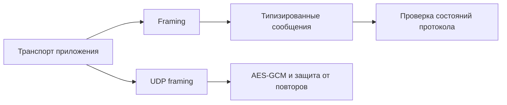

# OpenControl Protocol Library

[English](README.md) · **Русский**

[](https://github.com/nr084/opencontrol-protocol/actions/workflows/quality.yml)
[](rust-toolchain.toml)
[](LICENSE)

Самостоятельная Rust-библиотека OpenControl Protocol: кодеки сетевого формата,
проверка состояний протокола и криптографические примитивы сессии в одной зависимости.

**Crate:** `opencontrol-protocol` · **Версия библиотеки:** `0.1.0` · **Версии протокола:** `1–4`

## Возможности

- Инкрементальный framing управляющего потока: части сообщений и несколько кадров в одном чтении.
- Типизированные сообщения, конфигурация для разных версий и сохранение неизвестных сообщений без потерь.
- Точное кодирование, ограничения ресурсов и типизированные ошибки.
- Проверка порядка handshake и смены ключей для клиентской и серверной ролей.
- UDP framing, пакеты AES-128-GCM и защита от повторов для каждого слота ключа.
- Синтетические fixtures, эталонные векторы, property tests и три fuzz targets.

Приложение управляет сокетами, проверкой TLS, аутентификацией, временем, привязкой
UDP endpoint и сетевой конфигурацией. Парсинг синхронный и не требует async runtime.
В библиотеке нет VPN-сервера, управления TUN/TAP, установки маршрутов или настройки firewall.

## Архитектура



## Подключение

Добавьте Git-зависимость в `Cargo.toml` приложения:

```toml
[dependencies]
opencontrol-protocol = { git = "https://github.com/nr084/opencontrol-protocol.git", branch = "main" }
```

Для воспроизводимых сборок замените `branch` на `rev` проверенного коммита и
сохраните `Cargo.lock` приложения в Git. Для локальной копии укажите путь согласно своей структуре:

```toml
[dependencies]
opencontrol-protocol = { path = "../opencontrol-protocol/crates/opencontrol-protocol" }
```

Проект использует последний Rust stable через [rust-toolchain.toml](rust-toolchain.toml).
Для fuzzing с sanitizers применяется отдельный nightly toolchain.

## Использование

Приложение передаёт байты, уже расшифрованные его TLS-транспортом:

```rust
use opencontrol_protocol::*;

fn example() -> Result<(), ProtocolError> {
    let limits = ProtocolLimits::default();
    let mut decoder = ProtocolDecoder::new(limits);
    let incoming = [0x4b, 5, 0, 22, 4];
    let mut remaining = incoming.as_slice();

    while !remaining.is_empty() {
        let consumed = decoder.push_bytes(remaining)?;
        remaining = &remaining[consumed..];
        if let Some(frame) = decoder.next_frame()? {
            let message = ControlMessage::decode(frame, WireVersion::V4, limits)?;
            assert!(matches!(message, ControlMessage::Version(WireVersion::V4)));
        }
    }
    decoder.finish()?; // При EOF, а не между чтениями.

    let response = ControlMessage::Ok(vec![]);
    let outgoing = ProtocolEncoder::new(limits).encode(&response, WireVersion::V4)?;
    assert_eq!(outgoing.as_ref(), &[0x4b, 5, 0, 3, 0]);
    Ok(())
}
```

`push_bytes` принимает не более одного кадра за вызов. Заберите его через
`next_frame` перед передачей оставшихся байтов и сохраняйте decoder между чтениями.
После согласования версии используйте `StateMachine::version()` для выбора формата
payload. Передавайте state machine как полученные сообщения, так и успешно
отправленные ответы; приведённый пример показывает только работу кодеков.

`DataCipher` хранит один слот ключа. При ротации нужны два независимых слота:
установка ключа сбрасывает счётчики, переключение основного слота — нет.
`seal` создаёт nonce через генератор случайных чисел ОС. Перед передачей внутренних
пакетов используйте `Datagram::decode` и `DataCipher::open`. Приложение должно
проверить секрет CONNECT перед отправкой `SecretReceived`.

## Статус

API находится на стадии **до 1.0**. Версия crate не является версией сетевого
протокола; `opencontrol_protocol::VERSION` возвращает версию скомпилированной библиотеки.

Зафиксирована проверка совместимости через OpenControl Server 0.1.0 на Ubuntu
с wire V4. Этот результат относится к проверенному сценарию: совместимость с
остальными клиентами и платформами, длительная работа и готовность к production
пока не подтверждены. Синтетические fixtures явно обозначены и не выдаются за
захваты трафика клиента.

Утверждения о протоколе разделяются на **KNOWN**, **OBSERVED**, **INFERRED** и **UNKNOWN**.
Неизвестные поля остаются непрозрачными до подтверждения их семантики.

## Документация

Технические спецификации пока ведутся на английском языке.

| Документ | Содержание |
|---|---|
| [PROTOCOL.md](PROTOCOL.md) | Канонический сетевой формат, состояния, evidence и неизвестные поля |
| [ARCHITECTURE.md](ARCHITECTURE.md) | Границы модулей и обязанности приложения |
| [SECURITY.md](SECURITY.md) | Криптография, replay protection, секреты и ограничения безопасности |
| [TESTING.md](TESTING.md) | Тесты, fixtures, fuzzing и проверка совместимости |
| [PROJECT_STATE.md](PROJECT_STATE.md) | Текущее состояние реализации и оставшаяся работа |

## Разработка

Запускайте из корня репозитория:

```sh
cargo fmt --check
cargo clippy --workspace --all-targets --locked -- -D warnings
cargo test --workspace --locked
```

GitHub Actions выполняет проверки качества и короткий fuzz smoke на Linux nightly.
Короткий запуск не заменяет длительную проверку с sanitizers.

Для разбора извлечённого расшифрованного потока клиент→сервер:

```sh
cargo run -p opencontrol-protocol --example oc-dissect -- stream.bin 4
```

Инструмент использует кодеки библиотеки и выводит opcode, длину и состояние
порядка сообщений, не печатая payload. Разбор PCAP и расшифровка TLS в него не входят.

## Участие в проекте

[Создайте issue](https://github.com/nr084/opencontrol-protocol/issues) с воспроизводимой
ошибкой или предложением. Изменения протокола должны сопровождаться evidence и
санитизированной fixture либо regression test. Перед pull request выполните проверки
качества. Не публикуйте production credentials, ключи сессий и секреты привязки
в issues, captures или fuzz corpora. Порядок сообщения о проблемах безопасности
описан в [SECURITY.md](SECURITY.md).

## Лицензия

[MIT](LICENSE) — участники проекта OpenControl.
